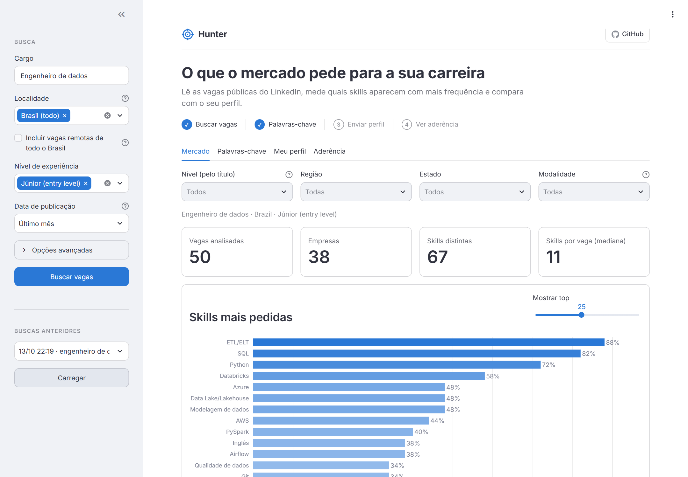
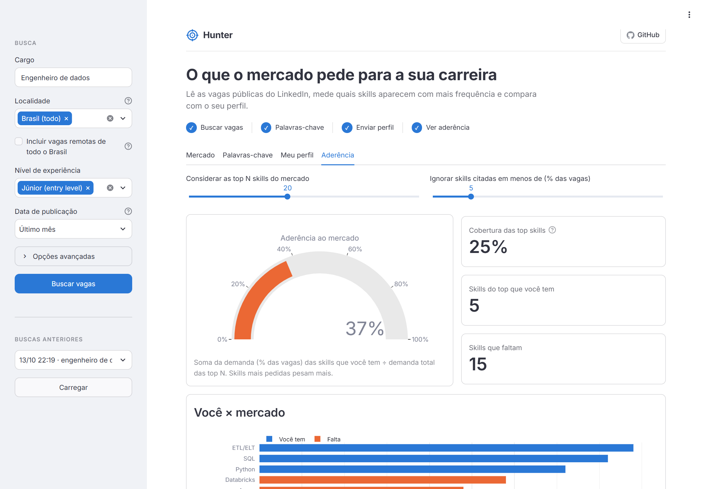
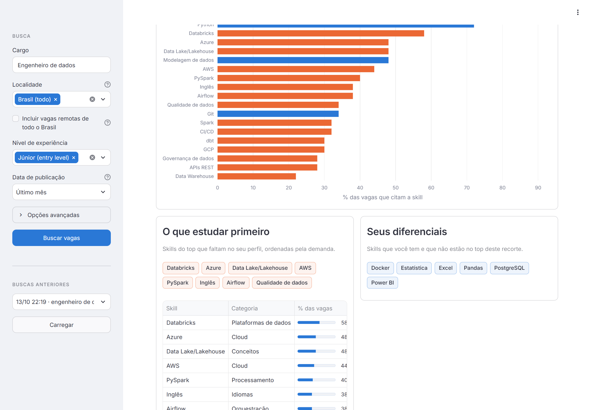
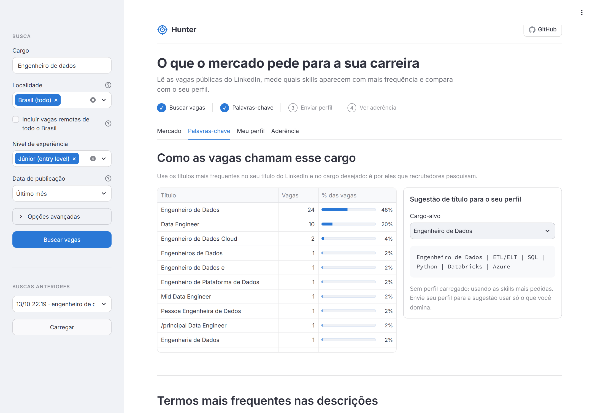
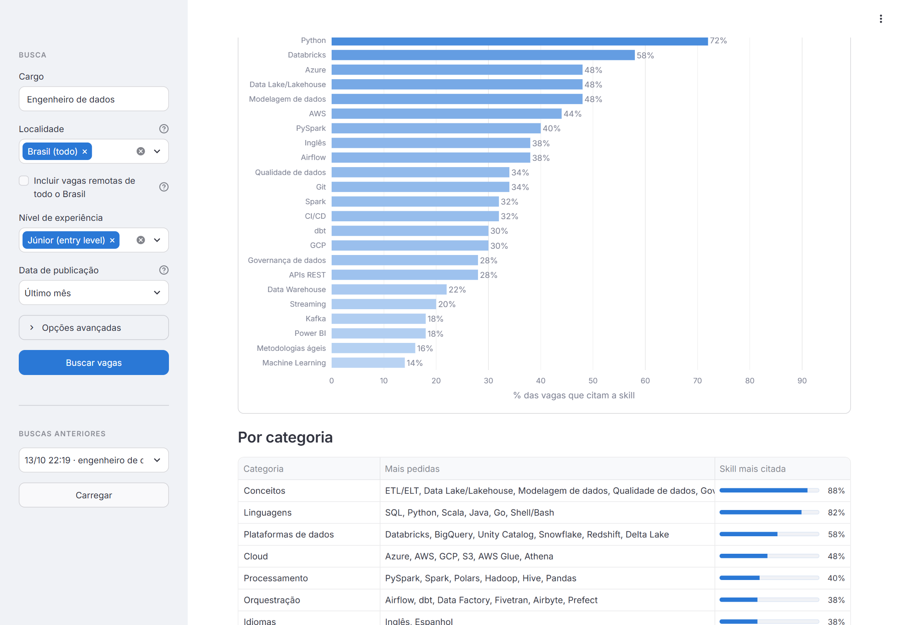

<div align="center">

# Hunter

**Descubra quais skills o mercado pede no LinkedIn para a sua carreira e quanto o seu perfil está aderente a ele.**




</div>

---

## Por que usar

Você quer uma vaga de *Engenheiro de dados júnior*. O que estudar primeiro: Databricks ou Airflow?
Vale colocar "ETL" no título do LinkedIn? O Hunter responde com dados: lê as vagas públicas do
LinkedIn para o cargo, a localidade e o nível que você escolher, mede **em quantas % das vagas
cada skill aparece** e compara com o seu perfil.

| | |
|---|---|
| **Mercado** | Ranking das skills mais pedidas, por categoria, estado e modalidade (remoto, híbrido, presencial). |
| **Palavras-chave** | Como as vagas chamam o cargo, termos mais frequentes nas descrições e sugestão de título para o seu perfil. |
| **Meu perfil** | Lê o ZIP de dados do LinkedIn, o PDF do perfil ou texto livre e detecta as suas skills. |
| **Aderência** | Nota de aderência ao mercado, o que estudar primeiro, seus diferenciais e as vagas com maior match. |

<table>
  <tr>
    <td></td>
    <td></td>
  </tr>
  <tr>
    <td></td>
    <td></td>
  </tr>
</table>

## Como rodar

### Windows, sem terminal

1. Instale o [Python 3.12+](https://www.python.org/downloads/) e marque **"Add python.exe to PATH"** na instalação.
2. Baixe o projeto: **Code → Download ZIP** nesta página, e extraia numa pasta.
3. Dê dois cliques em **`iniciar.bat`**. Na primeira vez leva alguns minutos (instala as dependências);
   depois o app abre sozinho no navegador. Para encerrar, feche a janela preta.

### Qualquer sistema

```bash
git clone https://github.com/guinho0/hunter.git
cd hunter
python -m venv .venv
# Windows: .venv\Scripts\activate    macOS/Linux: source .venv/bin/activate
pip install -r requirements.txt
streamlit run app.py
```

## Como usar

1. **Mercado**: informe cargo, localidade, nível e data de publicação (últimas 24 horas,
   última semana, último mês, últimos 3 meses ou qualquer data) e clique em **Buscar vagas**. A localidade aceita
   várias opções combinadas: `Brasil`, regiões (`Sudeste`), estados (`ES` ou `Espírito Santo`),
   cidades (`Vitória, ES`) ou qualquer lugar que o LinkedIn conheça (`Lisboa`). Depois, refine por
   nível, região, estado e modalidade. Use o filtro "nível pelo título": o filtro de nível do
   LinkedIn deixa passar vagas de outros níveis.
2. **Palavras-chave**: títulos de cargo mais usados, termos de 1 a 3 palavras mais frequentes nas
   descrições, quais faltam no seu perfil e trechos reais das vagas mostrando como cada termo é usado.
3. **Meu perfil**: envie o ZIP de dados (*Configurações → Privacidade de dados → Baixe seus dados*),
   o PDF do perfil (*Mais → Salvar como PDF*) e/ou texto livre. Revise as skills detectadas.
4. **Aderência**:
   - **Aderência ao mercado**: soma da demanda das skills que você tem ÷ demanda total das top N skills.
   - **Cobertura**: quantas das top N skills você tem.
   - O que estudar primeiro, seus diferenciais e as vagas com maior match.

## Privacidade

Tudo roda **no seu computador**. O app só faz requisições às páginas públicas de vagas do LinkedIn,
sem login. O seu perfil (ZIP, PDF ou texto) não sai da sua máquina, e as buscas ficam salvas em
`.cache/`, que não vai para o Git.

## Estrutura

| Arquivo | O que faz |
|---|---|
| `app.py` | Interface em Streamlit. |
| `hunter/ui.py` | Visual: CSS, cabeçalho, cards e estilo dos gráficos. |
| `hunter/taxonomy.py` | Catálogo de skills e apelidos (PT/EN). Para rastrear uma skill nova, adicione uma linha. |
| `hunter/linkedin_jobs.py` | Coleta as vagas pelos endpoints públicos `jobs-guest` (sem login), com cache em `.cache/jobs`. |
| `hunter/profile.py` | Lê o ZIP do export, o PDF e o texto livre. |
| `hunter/keywords.py` | Palavras-chave, títulos de cargo e sugestão de título. |
| `hunter/locations.py` | Converte cidade/estado/região em localidades do LinkedIn; detecta estado e modalidade. |
| `hunter/analysis.py` | Ranking, aderência e match por vaga. |

## Contribuindo

Sugestões e PRs são bem-vindos. O jeito mais fácil de ajudar é ampliar o catálogo em
`hunter/taxonomy.py` com skills da sua área. Encontrou um problema? Abra uma
[issue](https://github.com/guinho0/hunter/issues).

## Avisos

- O LinkedIn não oferece API pública de vagas e a coleta automatizada vai contra os Termos de Uso
  da plataforma. Use para fins pessoais e com volume baixo (o app já faz pausas e cache). O endpoint
  pode mudar ou passar a bloquear requisições (HTTP 429/999).
- A extração usa um dicionário de skills: é determinística e gratuita, mas só encontra o que está no catálogo.

## Licença

[MIT](LICENSE)
